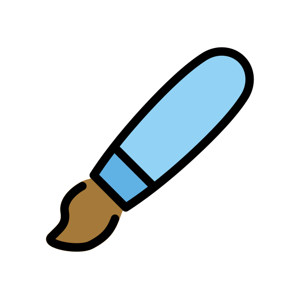
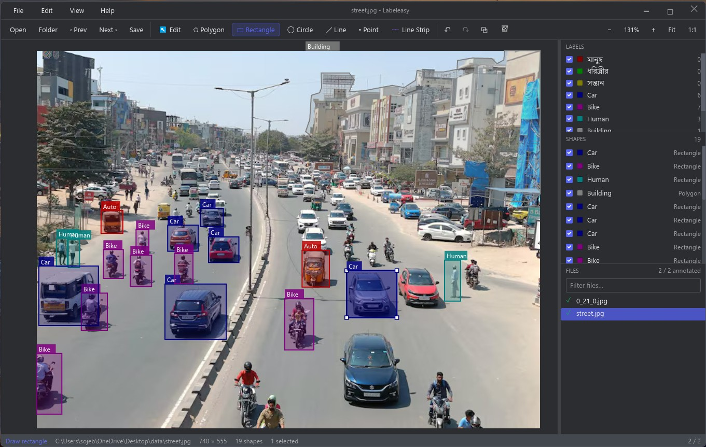

<div align="center">
    
</div>

## Labeleasy

Labeleasy is a fast, native image annotation tool written in Rust.

Few things inspired from my other project [Rustrest](https://github.com/SojebSikder/rustrest).



## Features

- **Shapes**: polygon, rectangle, circle, line, point and line strip.
- **Editing**: select / multi-select, move, drag vertices, insert a vertex by dragging an edge,
  Alt+click to remove one, duplicate, copy & paste across images, arrow-key nudging, undo/redo.
- **Labels**: label dialog with suggestions, group IDs, descriptions, per-shape and per-image flags,
  predefined label lists (`labels.txt`), optional validation, stable labelme (VOC) colors,
  per-label and per-shape visibility.
- **Datasets**: open a folder (optionally recursive) or files, natural sort, filter, annotated
  markers, "next unannotated", separate output folder, drag & drop, recent folders.
- **labelme compatible**: same JSON schema (`version`, `shapes`, `imagePath`, `imageData`, ...),
  unknown keys preserved, optional embedded image data, opens `.json` files whose image is only embedded.
- **Import/Export**: COCO instance segmentation, YOLO detection, YOLO segmentation, Pascal VOC.
- **Themes**: Zed-compatible theme files, light/dark/system mode.

## Usage

```bash
labeleasy                          # empty window: Ctrl+U opens a folder
labeleasy path/to/images           # open a folder
labeleasy image.jpg                # open the image's folder with it selected
labeleasy image.json               # open a labelme file
labeleasy images --output labels --labels labels.txt
```

Common shortcuts (all listed under **Help → Keyboard Shortcuts**, F1):

| Action                                                               | Keys                                                                                |
| -------------------------------------------------------------------- | ----------------------------------------------------------------------------------- |
| Next / previous image                                                | `D` / `A` (`Shift+D`: next unannotated)                                             |
| Edit mode / polygon / rectangle / circle / line / point / line strip | `E` / `P` / `R` / `C` / `L` / `T` / `S`                                             |
| Finish polygon                                                       | click the first point, double-click or `Enter` (`Backspace` removes the last point) |
| Save, undo, redo                                                     | `Ctrl+S`, `Ctrl+Z`, `Ctrl+Y`                                                        |
| Duplicate, copy, paste, delete                                       | `Ctrl+D`, `Ctrl+C`, `Ctrl+V`, `Delete`                                              |
| Zoom, fit, 100%                                                      | wheel or `Ctrl+=`/`Ctrl+-`, `Ctrl+F`, `Ctrl+0`                                      |
| Pan                                                                  | right/middle drag or `Space`+drag                                                   |

## Building

```bash
cargo run --release
cargo test --workspace
cargo clippy --workspace --all-targets -- -D warnings
```

Settings live in `<data dir>/Labeleasy/settings.json`; custom themes (any
[Zed theme](https://zed.dev/docs/themes) JSON) go in `<data dir>/Labeleasy/themes/` or can be imported
from Settings.

## Trademark

### Name

`Rustrest` is a trademark of [Sojeb Sikder](https://sojebsikder.me).

### Logo

This logo is sourced from [OpenMoji](https://openmoji.org/library/emoji-1F58C/). License: [CC BY-SA 4.0](https://creativecommons.org/licenses/by-sa/4.0/).

## License

[MIT](LICENSE)
